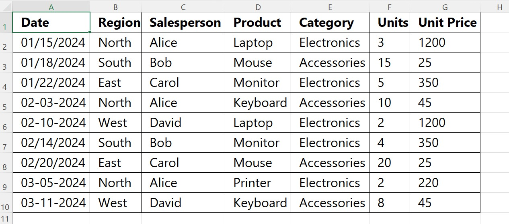

# Hospital Data Analysis Using Microsoft Excel

##   Project Overview

This project focuses on analyzing hospital data using Microsoft Excel to organize information, identify patterns, and generate meaningful insights.

As part of my Data Analytics training at the **American India Foundation (AIF)**, I worked on this hands-on project to gain practical experience in data cleaning, data analysis, PivotTables, and dashboard creation.

##  Project Objectives

- Understand and organize hospital-related data.
- Clean and prepare the dataset for analysis.
- Explore patient demographics and medical conditions.
- Analyze hospital admissions and insurance providers.
- Summarize information using PivotTables.
- Present key findings through an Excel dashboard.

##   Tools & Skills Used

- Microsoft Excel
- Data Cleaning and Preparation
- PivotTables
- Data Analysis
- Data Organization
- Dashboard Creation
- Data Visualization

##   Dataset Information

The project uses a hospital dataset containing approximately **50,000 records**.

The analysis focuses on four key areas:

- Patient Demographics
- Medical Conditions
- Hospital Admissions
- Insurance Providers

##   Work Performed

- Reviewed and organized the raw hospital dataset.
- Cleaned and prepared data for analysis.
- Created PivotTables to summarize hospital information.
- Explored different categories of hospital data.
- Compared information to identify patterns.
- Created an Excel dashboard to present the analysis visually.

##   Dashboard & Data Analysis

The project includes PivotTables and an Excel dashboard that provide different views of the hospital data.

The dashboard helps present key information visually, making it easier to explore categories, compare data, and understand patterns.

##   Project Screenshots

Screenshots of the Excel workbook, PivotTable analysis, and dashboard are included in this repository.
### Hospital Data Analysis

### Hospital Dashboard

##   Project Files

- `Hospital_Data_Analysis.xlsx` – Excel workbook containing the analysis and dashboard.
- `hospital_data.jpeg` – Hospital data screenshot.
- `Hospital_Dashboard_screenshot.jfif` – Dashboard screenshot.

##   Key Learnings

Working on this project helped me gain practical experience in handling large datasets, cleaning and organizing information, creating PivotTables, and building an Excel dashboard.

It also helped me understand how raw data can be transformed into meaningful information through structured analysis and visualization.

##   About Me

**Arti Gupta**

MCA Student | Aspiring Data Analyst

Currently developing my skills in Microsoft Excel, SQL, and Power BI through hands-on projects and continuous learning.

##   Acknowledgment

Grateful to the **American India Foundation (AIF)** for providing this hands-on learning opportunity as part of my Data Analytics journey.
